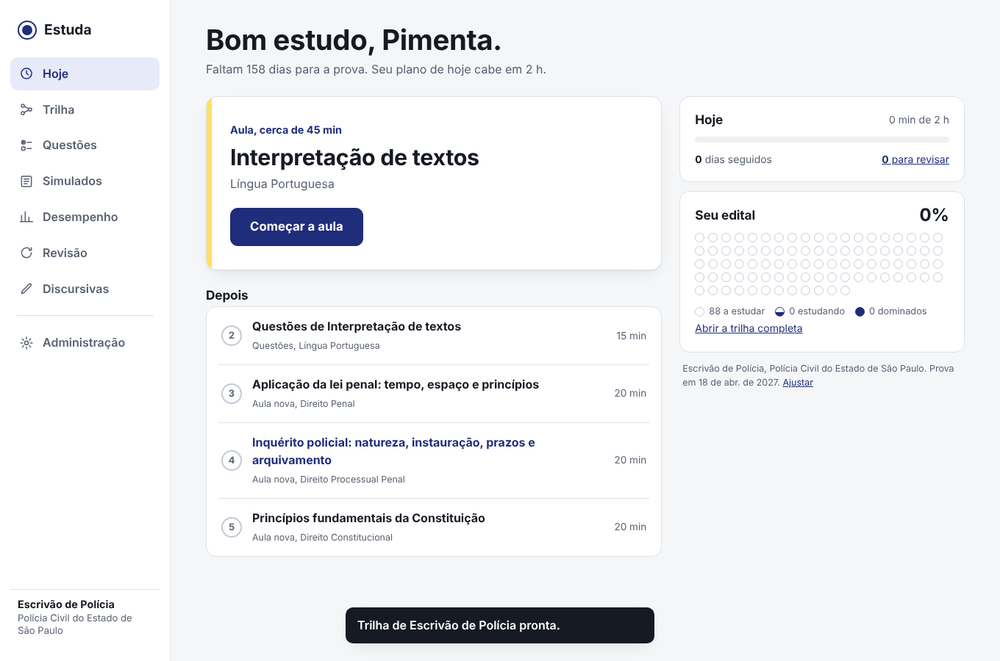
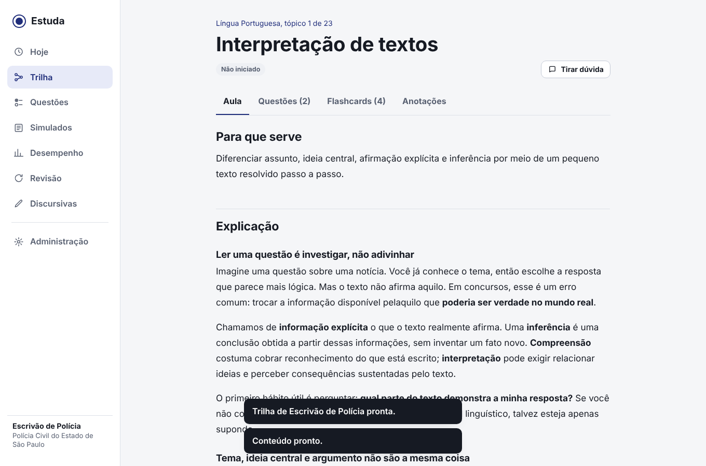
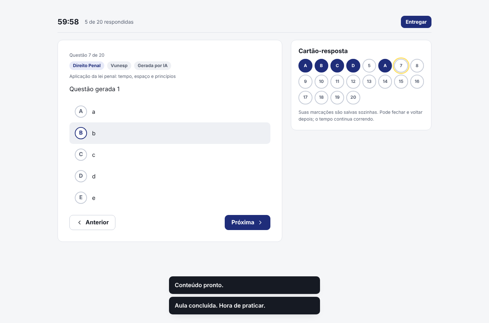
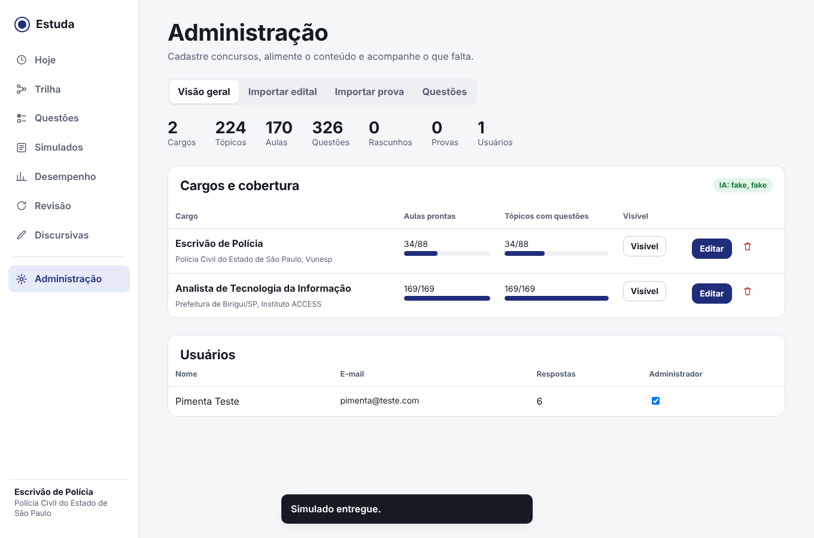

# Estuda: preparação para concursos com IA

Plataforma de estudo para concursos públicos. O aluno escolhe o concurso e o cargo, e recebe a trilha pronta com todas as matérias do edital: aulas didáticas, questões com correção na hora, flashcards com revisão espaçada, simulados com provas anteriores e acompanhamento de desempenho. A IA gera o conteúdo que faltar, lê editais e transforma PDFs de provas em simulados digitais.

Esta é a versão 2.0, sucessora do EstudaTI. Todo o conteúdo do EstudaTI (169 aulas, 321 questões, 604 flashcards e 27 discursivas) vem incluído no concurso da Prefeitura de Birigui.

## Como funciona para o aluno

O aluno cria a conta, escolhe o cargo (por exemplo, Escrivão de Polícia da PC-SP), informa a data da prova e quanto tempo tem por dia. A partir daí, a tela **Hoje** diz exatamente o que fazer: revisões que estão vencendo, reforço dos tópicos em que está errando, a próxima aula e as questões dela. O plano alterna entre as matérias conforme o peso de cada uma no edital, para avançar em todas ao mesmo tempo.

Cada tópico tem a aula, as questões, os flashcards e um espaço de anotações. Quando a IA está ligada, o botão **Tirar dúvida** abre um professor que responde com base na aula, e cada questão tem o botão **Não entendi, explica?**. Tópicos sem aula mostram o botão para gerar aula, questões e flashcards na hora.

Um tópico conta como **dominado** quando o aluno leu a aula e acerta 70% ou mais das últimas respostas em pelo menos 5 questões. Se acertar menos de 50%, ele entra em **reforço** e aparece no plano do dia. O mapa do edital na tela Hoje mostra um círculo por tópico, como um cartão-resposta sendo preenchido.

Os **simulados** podem ser personalizados (questões sorteadas com o peso de cada matéria, dando preferência às que o aluno nunca fez) ou de provas anteriores. Têm cronômetro, cartão-resposta, salvamento automático e correção com nota por matéria. Em provas de certo ou errado, a nota líquida desconta um acerto por erro, como no Cebraspe.

## Como funciona para o administrador

A primeira conta criada vira administradora. No menu **Administração** ela pode:

- **Importar edital.** Envie o PDF (ou cole o conteúdo programático). A IA identifica matérias, tópicos, número de questões, banca e data. Você confere, ajusta e cria a trilha. Matérias que já existem em outro concurso são reaproveitadas com as aulas que já tiverem: Português feito para um concurso serve para todos.
- **Gerar o que falta.** Na tela de um cargo, um botão gera com IA, em sequência, aula, questões e flashcards de todos os tópicos incompletos. Dá para pausar e continuar.
- **Importar prova anterior.** Envie o PDF da prova e o do gabarito (ou digite o gabarito). A IA separa as questões, casa com o gabarito e sugere a matéria de cada uma. Você revisa numa tela só e publica como simulado. Sem IA, um leitor local funciona em provas bem formatadas.
- **Importar questões** de arquivos CSV ou JSON (inclusive os formatos do EstudaTI antigo), com bloqueio de repetidas mesmo com alternativas em outra ordem.
- **Editar qualquer conteúdo**: aula em Markdown com prévia, questões, flashcards, pesos das matérias e tópicos.

Conteúdo gerado por IA fica marcado como tal para o aluno. Ao editar uma aula gerada, ela passa a constar como revisada.

## Rodar no seu computador

A interface já vem compilada em `frontend/dist`, então basta ter o Python 3.11 ou mais novo.

No Windows, dê dois cliques em `INICIAR_WINDOWS.bat`. No Mac ou Linux, rode `./INICIAR_MAC_LINUX.sh`. Na primeira vez ele prepara o ambiente (leva um ou dois minutos); depois abre `http://localhost:8000`. Crie sua conta: ela será a de administrador.

Para ligar a IA, copie `.env.example` para `.env` e preencha `AI_PROVIDER` e `AI_API_KEY` (as instruções estão no próprio arquivo). Feche e abra de novo.

Com Docker: `docker compose up -d --build` e acesse `http://localhost:8000`.

## Publicar na internet de graça

**Já usa o Render do EstudaTI?** Siga `docs/PUBLICAR_NO_RENDER.md`, feito para a estrutura atual (GitHub + Render + Neon + Vercel).

Para uma instalação do zero:

O caminho mais simples usa dois serviços com plano gratuito: o **Render** roda o site e o **Supabase** ou o **Neon** guardam o banco de dados (o disco do plano gratuito do Render é apagado a cada atualização, por isso o banco fica fora).

1. Crie um banco PostgreSQL no Supabase ou no Neon e copie a *connection string* (começa com `postgresql://`).
2. Suba esta pasta para o seu repositório no GitHub (sem o arquivo `.env`).
3. No Render, escolha **New > Blueprint** e aponte para o repositório. O arquivo `render.yaml` já configura tudo.
4. Preencha `DATABASE_URL` com a string do banco e, se quiser IA, `AI_PROVIDER` e `AI_API_KEY`.
5. Abra o endereço que o Render mostrar e crie a sua conta antes de divulgar o link.

O primeiro início no banco vazio carrega os pacotes de conteúdo e pode levar um minuto. No plano gratuito do Render o site "dorme" após um tempo parado e demora alguns segundos para acordar no primeiro acesso.

Se não quiser que qualquer pessoa crie conta, use `ALLOW_SIGNUP=0`. Defina também `ADMIN_EMAIL` com o seu e-mail: assim só você vira administrador.

## Custos de IA

A plataforma funciona sem IA com o conteúdo já incluído. A IA é paga por uso ao provedor escolhido (a assinatura do ChatGPT ou do Claude não cobre uso de API). Para reduzir custo, use um modelo mais barato em `AI_MODEL` (por exemplo `claude-haiku-5-5`) ou o Gemini, que tem camada gratuita com limites. Com `AI_PROVIDER=openai` e `AI_BASE_URL`, também dá para usar Groq, OpenRouter ou um modelo local pelo Ollama. Confira nomes de modelos e preços na documentação do provedor, porque mudam com o tempo.

Cada aluno tem um limite diário de pedidos à IA (`AI_DAILY_LIMIT`, padrão 40). Administradores não têm limite. O conteúdo gerado fica salvo e é compartilhado: um tópico gerado uma vez serve para todos os alunos.

## Direitos sobre o conteúdo

Provas e gabaritos costumam ser publicados pelas bancas e órgãos, mas confira as condições de uso de cada um. Não copie aulas, comentários ou questões comentadas de plataformas comerciais. Questões geradas por IA são marcadas como tal e não devem ser apresentadas como oficiais.

## Estrutura do projeto

```text
backend/            API em Flask (Python)
  app.py            início do servidor, login e entrega da interface
  api_study.py      rotas do aluno: plano do dia, trilha, questões, revisão, simulados, desempenho
  api_admin.py      rotas do administrador: concursos, edital, conteúdo, provas, usuários
  ai.py             integração com os provedores de IA e os prompts pedagógicos
  planner.py        progresso por tópico e montagem do plano do dia
  srs.py            repetição espaçada (estilo SM-2)
  importers.py      leitura de PDF, CSV e JSON
  schema.py, db.py  banco de dados (SQLite ou PostgreSQL)
  seed/packs/       pacotes de conteúdo carregados no primeiro início
  tests/            testes automatizados
frontend/           interface em React + TypeScript (Vite)
  src/pages/        telas
  dist/             interface já compilada
scripts/            conversor do conteúdo do EstudaTI antigo
docs/               guia de migração e formato dos pacotes
```

## Desenvolvimento

Backend: `cd backend && pip install -r requirements.txt && python app.py`. Testes: `cd backend && python -m pytest -q`.

Interface: `cd frontend && npm install && npm run dev` abre em `http://localhost:5173` com recarga automática, usando o backend da porta 8000. Para gerar a versão final: `npm run build`.

Variável útil nos testes: `AI_PROVIDER=fake` devolve respostas de IA previsíveis, sem custo.

## Telas





